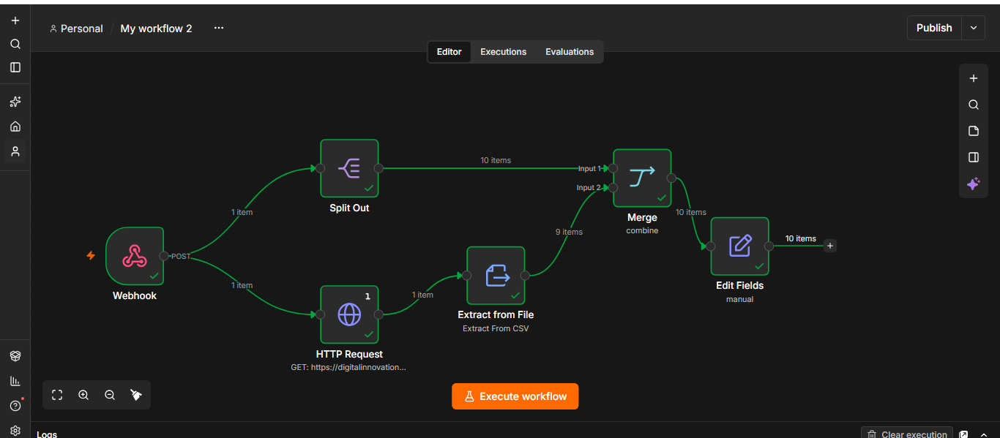

# Assistente de Investimentos com RPA e n8n

Automação que coleta dados de clientes com Python, processa tudo em um workflow no n8n e gera uma mensagem personalizada para cada perfil de investidor (Conservador, Moderado ou Arrojado).

Projeto desenvolvido no desafio da DIO, a partir do [repositório base](https://github.com/digitalinnovationone/dio-lab-assistente-investimentos-rpa-n8n).

## O que o projeto faz

1. **Extrai os clientes:** um script em Python (BeautifulSoup) lê uma página web com 10 clientes fictícios e coleta nome, e-mail, saldo e perfil.
2. **Envia ao n8n:** o script manda os dados para um webhook do n8n.
3. **Cruza com os investimentos:** o workflow lê o arquivo `data.csv` com as opções de investimento e combina cada cliente com as opções do seu perfil.
4. **Gera a mensagem:** cada cliente recebe uma mensagem de recomendação de acordo com o perfil.

## Fluxo no n8n

Webhook → Split Out (clientes) + HTTP Request (data.csv) → Extract from CSV → Merge → Edit Fields (campo `mensagem`)

## Tecnologias

| Etapa | Ferramenta |
| --- | --- |
| Extração (RPA) | Python + BeautifulSoup, no Google Colab |
| Orquestração | n8n (instalação local) |
| Conexão entre Colab e n8n | Webhook + ngrok |
| Dados | Página HTML e CSV no GitHub Pages |

## Estrutura do repositório

- `rpa/`: notebook Python que extrai os clientes e envia ao webhook
- `n8n/`: workflow exportado (`workflow.json`)
- `docs/`: página de clientes e CSV de investimentos
- `Fluxo_n8n.png`: print do fluxo funcionando

## Como rodar

1. Importe o `n8n/workflow.json` no seu n8n e ative o webhook (método POST, caminho `Clientes`).
2. Se o n8n estiver local, exponha com o ngrok.
3. Abra o notebook da pasta `rpa/` no Google Colab e troque `SEU_ENDERECO_NGROK` pelo endereço do seu n8n.
4. Execute o notebook. O workflow retorna uma mensagem para cada um dos 10 clientes.

## Resultado

Versão MVP concluída: o fluxo roda de ponta a ponta e gera as mensagens a partir de templates fixos por perfil.

## Próximo passo possível

Conectar um Agente de IA do n8n a um modelo de linguagem para gerar mensagens únicas, considerando saldo e perfil de cada cliente (desafio extra do curso).
